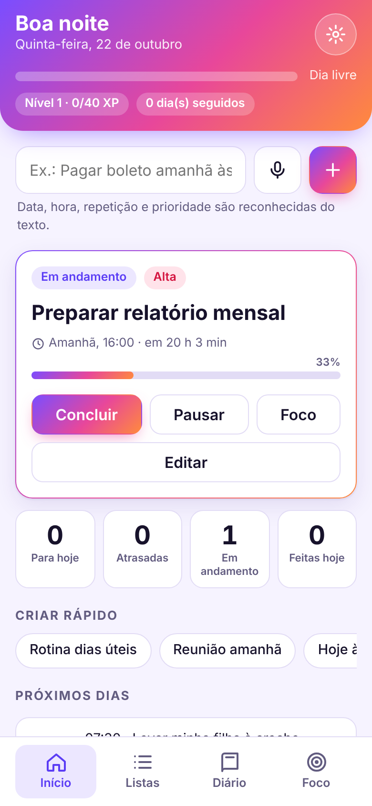
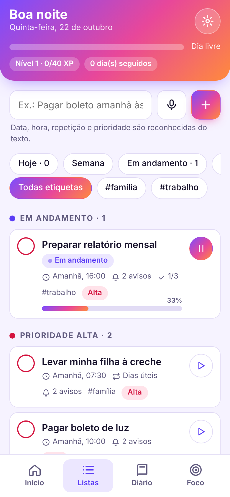
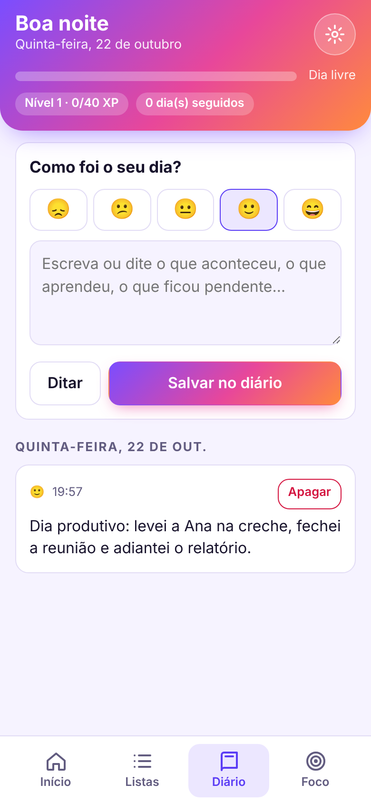
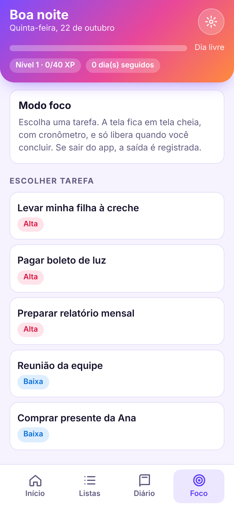

# Seu Assistente

Gerenciador de tarefas e diário para Android, feito para lembretes que não deixam nada passar. Você fala ou digita, o app entende data, hora, repetição e prioridade, avisa na hora certa e transforma o dia em progresso com níveis, sequências e metas.

O app é leve de propósito: só texto e voz, sem anexos, e os dados ficam no seu aparelho.

<p align="center">
  
  
  
  
</p>

## Baixar e instalar

1. Abra a página de [**Releases**](https://github.com/Rafajames/seu-assistente/releases/latest) no celular e baixe o arquivo **seu-assistente.apk**.
2. Abra o arquivo. O Android pede para permitir a instalação de fontes desconhecidas, porque o app ainda não está na Play Store.
3. No primeiro uso, vá em **Ajustes → Notificações do sistema → Ativar** e permita as notificações.
4. Para os avisos chegarem na hora exata:
   - Android 12 ou mais novo: Configurações → Apps → Seu Assistente → **Alarmes e lembretes**.
   - Tire o app da economia de bateria. Em Xiaomi, Samsung, Motorola e similares, o sistema costuma atrasar avisos de apps que não estão liberados.

As versões novas instalam por cima da anterior e mantêm seus dados, porque todas usam a mesma assinatura.

## O que ele faz

**Tarefas**
- Escreva do jeito que falaria. O app reconhece data, hora, repetição, etiqueta e prioridade (veja os exemplos abaixo).
- Prioridade automática (alta, média, baixa) por palavras como "urgente" e pela proximidade do prazo. Ela muda sozinha quando o prazo chega.
- Subtarefas, etiquetas (`#trabalho`), barra de progresso e botão para marcar como **em andamento**.
- Rotinas em dias específicos: de segunda a sexta, só fins de semana, toda terça e quinta, todo dia 10.
- Aba **Semana** com os próximos 7 dias, incluindo as ocorrências previstas das rotinas.

**Lembretes**
- Vários avisos por tarefa (no horário, 10 min antes, 1 h antes, 1 dia antes ou um tempo personalizado).
- Avisos agendados pelo Android, que tocam com o app fechado.
- Insistência a cada 30 minutos em tarefas atrasadas, com botão de adiar.
- Horário de silêncio, resumo do dia e revisão semanal.

**Voz e diário**
- Ditado por voz para criar tarefas e escrever no diário.
- Diário com humor do dia e a lista do que você concluiu em cada dia.

**Gamificação e compartilhamento**
- XP, níveis, sequência de dias, meta diária e conquistas.
- Ao concluir uma tarefa ou bater uma meta, compartilhe no WhatsApp com a mensagem já pronta.

**Modo foco**
- Escolha uma tarefa e fique em tela cheia com cronômetro até concluí-la. As saídas do app são registradas.

**Aparência e acessibilidade**
- Tema claro, escuro ou automático, texto grande, alto contraste e opção de reduzir animações.

## Frases que o app entende

| Você escreve | O app cria |
| --- | --- |
| `Pagar boleto amanhã às 15h, urgente` | Prioridade alta, amanhã às 15:00 |
| `Levar minha filha à creche de segunda a sexta às 7h30` | Rotina nos dias úteis, 07:30 |
| `Reunião toda segunda e quarta às 9h #trabalho` | Rotina semanal com a etiqueta trabalho |
| `Ligar para a mãe daqui a 2 horas` | Hoje, daqui a duas horas |
| `Entregar relatório dia 5 de novembro às 14h` | Dia 5 de novembro, 14:00 |
| `Pagar aluguel todo dia 10` | Repete todo mês, no dia 10 |
| `Faxina fins de semana de manhã` | Sábado e domingo, 09:00 |
| `Jantar com a família hoje à noite` | Hoje às 20:00 |

## Limitações conhecidas

- **Login na nuvem:** não está disponível no APK. O Google bloqueia login dentro do navegador embutido do app, então a sincronização com Google Drive, Dropbox e OneDrive só funciona na versão web (veja abaixo). No APK, use o backup em arquivo, em Ajustes.
- **Modo foco:** é uma tela cheia dentro do app. Ele não consegue travar o celular de verdade.
- **Palavra de ativação** ("Assistente", como a Alexa) com a tela apagada: ainda não existe.
- **Localização:** o aviso por lugar só funciona com o app aberto.
- O APK é de teste, assinado com a chave de depuração. Não serve para publicar em loja.

## Privacidade

Tarefas, diário e metas ficam no armazenamento do próprio aparelho. Não existe servidor do app. A nuvem é opcional, só na versão web, e usa a pasta privada do app na conta que você escolher.

## Estrutura do projeto

```
www/                    O app (HTML, CSS e JavaScript em um único arquivo)
android/                Projeto Android gerado pelo Capacitor
capacitor.config.json   Configuração do Capacitor
.github/workflows/      Compilação do APK e publicação na página de Releases
docs/                   Imagens deste README
```

Plugins nativos: `@capacitor/local-notifications` (avisos) e `@capacitor-community/speech-recognition` (voz).

## Como compilar

### Pelo GitHub (sem instalar nada)

- A cada envio para `main`, o fluxo **Compilar APK** gera o APK e o guarda em *Actions → Artifacts*.
- Para publicar uma versão na página de Releases, crie uma tag que comece com `v`:

  ```bash
  git tag v1.1.0
  git push origin v1.1.0
  ```

  O fluxo compila, usa o número da tag como versão do app e cria a Release com o arquivo `seu-assistente.apk`.

### No seu computador

Precisa de Node 22, JDK 21 e Android Studio.

```bash
npm install
npx cap sync android
cd android && ./gradlew assembleDebug
```

O APK sai em `android/app/build/outputs/apk/debug/app-debug.apk`.

## Versão web (PWA)

O mesmo `www/index.html` funciona no navegador do celular ou do computador e pode ser instalado na tela inicial, no Android e no iPhone. É nele que a nuvem funciona. Para usar:

1. Publique a pasta `www/` em qualquer hospedagem com HTTPS (Netlify, Vercel, GitHub Pages).
2. Crie um app de login em cada nuvem que quiser oferecer e cole os identificadores no bloco `const CFG=` do `index.html`. O provedor deixado em branco aparece desativado.

   | Nuvem | Onde cadastrar | O que informar | Identificador |
   | --- | --- | --- | --- |
   | Google Drive | console.cloud.google.com | API do Drive ativada, escopos `drive.appdata` e `userinfo.email`, origem JavaScript = endereço do app | ID do cliente |
   | Dropbox | dropbox.com/developers/apps | Pasta própria do app, permissões `files.content.read`, `files.content.write`, `account_info.read`, URI de retorno = endereço completo do app | App key |
   | OneDrive | portal.azure.com | Plataforma "Aplicativo de página única", permissões `Files.ReadWrite.AppFolder` e `User.Read`, URI de retorno = endereço completo do app | ID do aplicativo |

Os dados ficam no arquivo `assistente.json`, na pasta privada do app. O app não enxerga os outros arquivos da pessoa. Em conflito entre aparelhos, vale a alteração mais recente. No iPhone, o login do Google é o mais confiável.

Avisos com o app totalmente fechado, na versão web, exigem um servidor de Web Push. Só o APK agenda avisos pelo sistema.

## Próximos passos

- Login nativo na nuvem dentro do APK.
- Palavra de ativação "Assistente" com a tela apagada.
- Modo foco com bloqueio real.
- Widget na tela inicial e atalho para criar tarefa rápido.
- Aviso por localização com o app fechado.

## Licença

Ainda sem licença definida.
